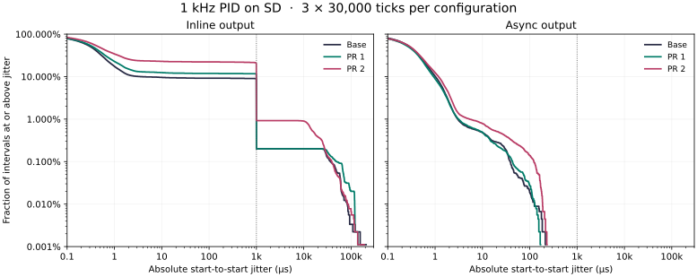

# SD-card writeback comparison

The proposed 1 MiB or 100 ms policy increased deadline misses with inline logging and increased PID recording loss with asynchronous logging. Extending the age limit to 1 second recovered more data on both example workloads. The 1 kHz PID loop also had a worse async jitter tail at the longer interval.

## 1 kHz PID

Each revision and mode ran three times for 30 seconds on the same ext4 SD card. Each CL contains about 2.13 KB of encoded measurements and PID output. Start-to-start jitter is the absolute deviation from the 1 ms period. Late finishes are counted against the original release schedule, including ticks that started late.

| Per 90,000 ticks | Base | PR 1 ranges | PR 2 at 100 ms |
| --- | ---: | ---: | ---: |
| Inline deadline misses | 8,121 | 10,524 | 19,336 |
| Inline dropped CLs | 0 | 0 | 0 |
| Inline p99.9 jitter | 36.62 ms | 50.44 ms | 39.18 ms |
| Inline longest interval between starts | 209.49 ms | 142.18 ms | 190.44 ms |
| Async deadline misses | 0 | 0 | 0 |
| Async dropped CLs | 7,888 | 10,037 | 16,148 |
| Async p99 jitter | 3.01 µs | 3.14 µs | 5.40 µs |
| Async p99.9 jitter | 38.88 µs | 43.30 µs | 122.72 µs |
| Async longest interval between starts | 1.21 ms | 1.17 ms | 1.23 ms |

## 20 Hz image alignment

The example aligns two pooled 640×480 grayscale streams. All configurations used the initial keyframe. The baseline and both branches failed on the second keyframe in a separate run with captures every 20 ticks. The aligner buffers were empty when their serialized size was estimated at startup. At tick 20 the populated buffers exceeded the available snapshot space. [Reproduction](verification/image-keyframe-repro.log)

| Per 900 frames | Base | PR 1 ranges | PR 2 at 100 ms |
| --- | ---: | ---: | ---: |
| Inline deadline misses | 610 | 836 | 841 |
| Inline ticks lasting over 50 ms | 269 | 257 | 408 |
| Inline dropped CLs | 0 | 0 | 0 |
| Async deadline misses | 0 | 0 | 0 |
| Async dropped CLs | 198 | 268 | 223 |
| Async recovered CLs | 702 | 632 | 677 |

The camera window depends on arrival times. Inline output averaged 1.49, 1.67 and 1.26 MB per recovered CL respectively. Fewer long-running ticks on PR 1 still left more frames completing late because delays carried into subsequent releases.

## Writeback age

An additional paired comparison alternated the PR 2 binaries within each repetition. The only source change was `MAX_AGE` from 100 ms to 1 s. The size trigger stayed at 1 MiB and closed sections remained immediately eligible. These limits determine when the runtime checks for work. A synchronous flush on an already busy worker can finish later.

| Three paired runs | 100 ms | 1 s |
| --- | ---: | ---: |
| PID inline deadline misses / 90,000 | 20,098 | 7,555 |
| PID async dropped CLs / 90,000 | 16,530 | 6,662 |
| PID async deadline misses / 90,000 | 0 | 12 |
| PID async p99.9 start jitter | 52.45 µs | 243.90 µs |
| PID async longest final drain | 147.95 ms | 45.53 ms |
| Camera inline deadline misses / 900 | 783 | 723 |
| Camera async dropped CLs / 900 | 232 | 190 |
| Camera async deadline misses / 900 | 0 | 0 |
| Camera async longest final drain | 473.96 ms | 74.25 ms |

All 12 late PID completions at 1 s occurred in one of the three runs. One tick took longer than 1 ms. The worst start lateness in that run was 1.36 ms. The example recorded timestamps in userspace and cannot attribute the late starts to a particular kernel wait.

Every completed run reopened a clean log and recovered exactly the number of accepted CLs. The blocked-flush test also checked keyframe pairing, structured overflow reporting and ordered recovery. [Per-run metrics](verification/example-runs.csv) · [Pooled metrics](verification/example-groups.csv) · [Blocked-flush test](verification/barrier.log) · [Workloads, controls and reproduction](verification/METHOD.md)
