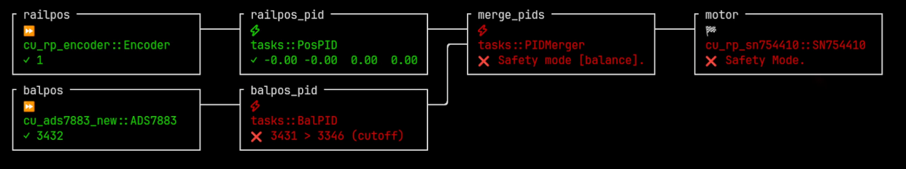

# ConsoleMon

</img>

Note: This is part of the Copper project. See the main project page for context.

The ConsoleMon is a simple monitor that display the current state of the robot to the console in an TUI.
It is useful for monitoring a robot quickly over ssh or in a terminal.

## Usage

Add it as a dependency in your `Cargo.toml`:

```tom
[dependencies]
cu-consolemon = "*"
```

And in you copperconfig.ron:

```ron
(
    tasks: [
        ( ...
        ),
     ],
    cnx: [
        ( ... ),
    ],

    monitor: (
        type: "cu_consolemon::CuConsoleMon", // <== Here
    )
)

```

The monitor offers these screens (some are feature-dependent):

- **SysInfo**: A quick system information screen (CPU, Memory, Distrib ...)
- **DAG**: A Directed Acyclic Graph of the tasks with their real time error status and short string info.
- **HOP**: Explore a task and its neighbors with live status and timing.
- **CLK**: Live robot time and origin, available for local and synchronized clocks.
- **Latencies**: A list of the tasks with their real time latencies & assorted statistics (Jitter, Min, Max, Avg).
- **Bandwidth**: CopperList serialization and IO statistics.
- **Memory Pools**: A list of the memory pools with their real time usage and statistics (Pool ID, Used/Total, Buffer Size, Handles in Use, Handles/sec).
- **Debug Output** [`debug_pane`](#debug_pane-feature): The shared `cu_tuimon` log pane showing Copper live logs and captured `stderr`.

## `debug_pane` feature

Enabled by default. Disable with `default-features = false`. Displays real-time logs
from Copper structured logging (`debug!`, `info!`, `warn!`, `error!`) and captured `stderr`.

## CLK panel

CLK always shows the application's shared `RobotClock`, its live time, and its
origin. Ordinary clocks show LOCAL with a local monotonic or mock counter. The
optional `clock-sync` feature enables clock discipline; synchronized clocks open
CLK initially. It has two bordered panes side by side: **Clock / reference**
for live time and alignment, and **Timestamp uncertainty** for bounds and limits.
Use arrow keys to scroll on narrow terminals. **Robot vs reference** shows the signed
difference: positive is ahead, negative is behind. **Uncertainty bound** shows the conservative
total and its reference/capture, sample-aging, and clock-mismatch contributions.
It includes configured allowances rather than measuring total clock error.
**Allowed uncertainty** is the configured maximum; exceeding it expires a locked
or holdover clock. The panel also shows estimated drift, sample age, reference
identity, and domain. Clock sampling and formatting happen on the UI thread;
no per-iteration clock telemetry is added to the task graph.

Try the [standalone PTP demo](../../../examples/cu_clock_sync/README.md).
