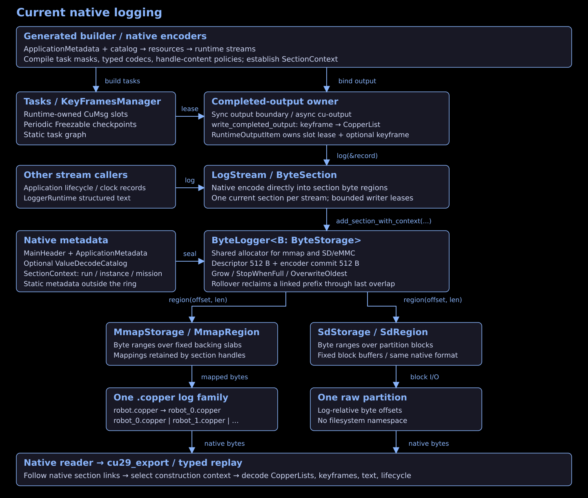
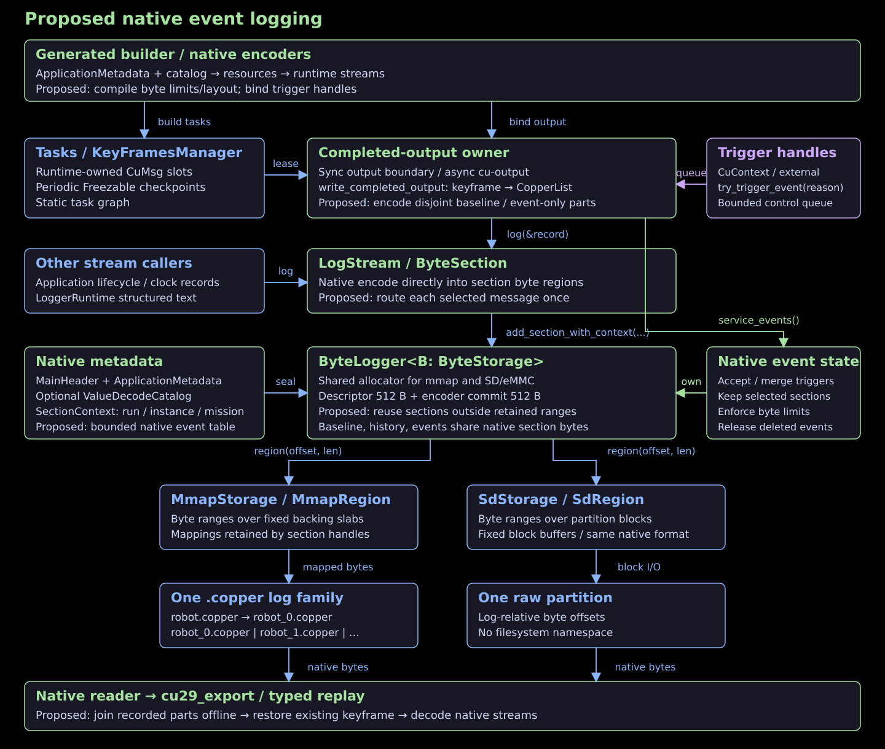

# Event-based logging

**Proposal; none of the event APIs below exist yet.** Compatibility is optional.
This changes how recordings are kept and selected; the existing native payload
encoders remain the starting point.

Extend the universal logger for mmap slabs and raw SD/eMMC partitions. Copper
owns byte allocation and retained ranges on both backends.

## 1. Goal

For `camera → detector → tracker → planner`, keep detections routinely and retain
camera data around an interesting observation. Configure byte budgets for past
and future capture. Log readers derive timing and duration from existing records.

An event starts at an existing retained keyframe and ends at a complete
CopperList. The range can occupy several ordinary native sections and share
boundary sections with neighboring ranges. A keyframe interval has no fixed
storage slot or maximum size of its own. Existing keyframes remain state recovery
points; event tooling reuses them without extra freezes.

**A trigger saves already recorded data.** It cannot recover images that were
never written. Continuous capture still pays encoding, storage bandwidth, and
flash wear; events reduce permanent storage and upload volume. Past data lives
on the medium, not in a queue of sensor handles. A trigger changes which native
sections remain retained without copying the past recording.

## 2. User API

### Enable and select data

Select event data in each task's existing `logging` block, beside its main-log
selection. The proposed `logging.events: bool` defaults to `false` and applies to
all outputs of that task. Existing `logging.enabled` keeps its main-log meaning
and default `true`; the two selections are independent. Streaming/telemetry
settings remain on the task as today.

For the camera/detector/tracker application, the relevant declarations are:

```ron
tasks: [
    (
        id: "camera",
        type: "tasks::Camera",
        logging: (enabled: false, events: true),
    ),
    (
        id: "detector",
        type: "tasks::Detector",
        logging: (enabled: true, events: true),
    ),
    (
        id: "tracker",
        type: "tasks::Tracker",
        logging: (enabled: true, events: true),
    ),
],
```

Keep the application's existing connections and other task fields. Camera output
is event-only; detector and tracker output belongs to both selections. For
main-log-only output, use `logging: (enabled: true, events: false)`; with both
flags false, neither log selection captures that task's outputs. These flags
select data, not permission to trigger an event: any running task can trigger.

The top-level `logging.events` section configures shared capacities and policy:

```ron
logging: (
    enable_task_logging: true,
    enable_keyframe_logging: true,
    keyframe_interval: 100,
    section_size_mib: 1,
    events: (
        history_bytes: 1073741824,
        saved_bytes: 4294967296,
        before_bytes: 536870912,
        after_bytes: 134217728,
        max_event_bytes: 1073741824,
        baseline_bytes: 268435456,
        max_events: 64,
        trigger_queue_capacity: 32,
    ),
),
```

Both examples are fragments of `copperconfig.ron`; only the task-level `events`
flag and the top-level event configuration are new. The routine main log is called
the **baseline** below. There is no task-name selection list under the global
event section. Code generation derives typed baseline/event masks from the local
flags, including event-only tasks whose main-log `enabled` flag is false.

For a bridge Rx output, propose the same `NodeLogging` block on its declaration:
`Rx(id: "frames", logging: (enabled: false, events: true))`. This extends the Rx
schema; it is not a field accepted today. Selection remains with the producing
task or channel. Bridge Tx inputs are already selected at their producer.

No new Cargo feature is required. With all local event flags false and the global
section omitted, ordinary logging is unchanged. A local event flag without global
budgets, or global budgets without any selected output, is a compile-time error.
`cu29/async-cl-io` remains an optional output placement; the same native retention
implementation serves `std` and `no_std`.

A slot shared by baseline and event capture has one representation and codec
state. Events do not introduce a second codec or override handle policies. Select
full handle contents and a lossless representation for inputs needed by replay;
codec correctness remains its existing contract. Capture must also decode from
the chosen starting point: losslessness alone does not establish that. A codec
requiring discarded earlier records is unsupported for that range; verify cropped
decoding offline rather than adding codec snapshots on the robot. Validate
incompatible static settings at compile time. Partial capture supports inspection and whichever
subgraph has all its required recorded inputs; it is not a promise of whole-app
replay.

| Parameter | Default / limits / meaning |
| --- | --- |
| `tasks[].logging.events: bool` | Default `false`; include all outputs of that task in event capture, independently of main-log `logging.enabled` |
| Rx channel `logging.events: bool` | Default `false`; same selection on that producing channel; proposed reuse of `NodeLogging` on Rx declarations |
| Top-level `logging.events` | Absent by default; required when any local event flag is true; contains only shared budgets/policy; remaining fields below belong here |
| `history_bytes: u64` | Required; positive, backend-aligned rolling capture capacity; `before_bytes <= history_bytes` |
| `saved_bytes: u64` | Required; aligned saved-section capacity; at least `max_event_bytes`; shared sections count once |
| `before_bytes: u64` | Required; nonnegative target for capture preceding the trigger; rounded to a usable retained keyframe |
| `after_bytes: u64` | Required; nonnegative target for capture after the trigger; stop at a complete CopperList |
| `max_event_bytes: u64` | Required; aligned hard cap on sections retained by one event, including repeated triggers; `before_bytes + after_bytes <= max_event_bytes <= saved_bytes` with checked arithmetic |
| `baseline_bytes: u64` | Default `0`; zero disables routine retention; otherwise an aligned capacity for baseline records |
| `max_events: u16` | Default `64`; `1..=65535` saved event descriptors, including the event currently collecting |
| `trigger_queue_capacity: u16` | Default `32`; `1..=65535` queued requests per application |
| Global logging switches | Top-level `enable_task_logging` and `enable_keyframe_logging` must be true; `keyframe_interval` must be present and positive; per-task main-log `enabled` may be false |

Hard capacities are multiples of 512 B and must accommodate the configured native
section allocations; byte targets need not be aligned. Byte targets use sizes
already observed by native encoding. Hard capacities count
allocated sections, including headers and boundary slack. Keyframes and section
boundaries make the resulting window approximate. There is no byte-to-seconds
estimator, sizing encode, or fixed capacity per keyframe interval.

Compile selections, capacities, arithmetic checks, section geometry, and memory
requirements from RON. Startup validates actual medium bounds and backend
alignment, which cannot always be known at compile time. Reserve the history,
saved, and baseline quotas plus bounded native event metadata and the live-section
headroom required by the compiled streams. Shared sections occupy storage once.

Use the usual `.with_log_path(...)` for mmap or `.with_logger(...)` for SD/eMMC.
The generated builder applies the native layout before creating streams. A
supplied logger must support the configured capacities. Host paths and slab sizes
remain backing-storage choices.

### Trigger

The runtime supplies the endpoint in `CuContext`:

```rust
// Inside an existing task's process callback.
if interesting {
    match ctx.try_trigger_event(CuEventReason(7)) {
        CuEventSubmission::Queued => {}
        CuEventSubmission::QueueFull => { /* retry or count in application code */ }
        CuEventSubmission::Disabled | CuEventSubmission::NotRunning => {}
    }
}
```

`CuEventReason` is an application-defined `u16`. The request carries the existing
cycle/component identity and reason. It contains no new timestamp, payload, or
per-call window override. `Queued` means submitted; the output owner still has
to check retained history and capacity. Its acceptance, merge, or rejection is
recorded in the native log. There is no ticket/result-expiration protocol.

For a button, remote handler, or application-owned thread, obtain
`let trigger = app.event_handle()` before `app.run()`, then call the same method
on that handle. External requests anchor at the next completed cycle serviced by
the output owner. This avoids publishing an extra latest-cycle counter on every
robot iteration. Readers use that cycle's existing timestamps.

```rust
impl CuContext {
    pub fn try_trigger_event(&self, reason: CuEventReason) -> CuEventSubmission;
}
impl CuEventHandle {
    pub fn try_trigger_event(&self, reason: CuEventReason) -> CuEventSubmission;
}
```

Submission makes a bounded, allocation-free queue attempt. Queue contention can
return `QueueFull`; the caller never waits for storage. Disabled configuration,
replay, and callbacks outside active processing return `Disabled` or `NotRunning`.
The existing output owner handles requests in synchronous and asynchronous
placements. Event logging adds no control worker or per-cycle clock read.

### Boundaries, spam, and overlap

At admission, choose the earliest retained keyframe whose prefix through the
trigger fits the past-byte target. If even the nearest preceding keyframe needs
more than that target, keep its necessary prefix provided it fits the hard event
cap. Reject `HistoryUnavailable` if no usable starting keyframe remains, or
`EventLimit` if including the trigger would exceed the cap. Ordinary capture
continues when a keyframe interval is larger than a requested event window.

Keep complete CopperLists until the future-byte target is reached. Section slack
or variable record sizes can make the hard cap arrive first; finish at the last
complete list and record `CapacityLimit`. Do not discard a whole keyframe interval
because it outgrew an artificial slot, or force another keyframe at the end.

| Situation | Behavior |
| --- | --- |
| Startup has less past history | Retain the available usable prefix; readers determine the shortfall from recorded references and config |
| Trigger lies in the collecting event | Merge into that event and extend its future target within `max_event_bytes` |
| Spam would exceed the event cap | Reject the extension; keep the previously accepted range |
| Duplicate changes no retained range or reason | No event-metadata write |
| Overlap with a completed event | New event ID, sharing existing native sections |
| Queue full | Immediate `QueueFull`; no submission |
| Event table or saved quota full | Record rejection; retain accepted events and continue rolling history |
| Missing output, storage error, or early stop | Preserve the last complete range and record the actual failure |

Only one event collects future data at a time. A delayed request that falls
outside it is rejected as `Busy`; no interval-merging scheduler is introduced.
Reserve the remaining hard cap for that collecting event, release unused space
on completion, and charge shared sections once. Merging keeps the first and last
reason/origin. It does not add trigger counters or a history of duplicate calls.

An event descriptor stores its ID, starting keyframe reference, trigger cycle,
last complete record reference, reasons, and terminal state/cause. Update it only
when these values change. Log readers compute timestamps, duration, coverage,
replay readiness, and inspection indexes from original records.

Read/export events while the logger is stopped and opened for inspection.
Proposed `app.delete_event(id) -> CuResult<()>` also requires a stopped logger
and exclusive access; deleting a collecting event returns a busy error. There
is no live-reader lease protocol. Deletion releases that event's ownership;
other events or rolling retention can still keep the same sections. Saved events
are not automatically evicted.

## 3. Copper today

These objects are different sizes and have different owners:

| Notion | Concrete meaning |
| --- | --- |
| CopperList | One runtime cycle's messages and metadata; lives in a reusable arena slot |
| KeyFrame | Frozen task/bridge state used to resume replay; associated with a CopperList |
| Stream | A typed writer for a record family, such as CopperLists or keyframes |
| Section | A byte range allocated to a stream; its header tracks type, context, links, and committed bytes |
| Slab | One backing file/mapping; a section can cross slab boundaries |



| Existing component | Relevant behavior |
| --- | --- |
| Generated encoder | Compile task/slot masks, codecs, handle policies, and metadata/catalog layout |
| `KeyFramesManager` | Produce existing scheduled `Freezable` state recovery points |
| `write_completed_output` | Write the keyframe before its associated CopperList in both placements |
| `AsyncCopperListsManager` | Keep the completed slot lease through output; reuse it only after consumers finish |
| `LogStream` / `ByteSection` | Encode into native sections; expose actual encoded byte counts |
| `ByteLogger<B: ByteStorage>` | Shared mmap/SD allocator; current rollover reclaims a linked prefix through the last overlap |
| `MmapStorage` / `SdStorage` | Supply byte regions over backing slabs or partition blocks |

Two existing constraints require real changes. The allocator cannot skip retained
middle sections. The current CopperList encoder writes a complete selected tuple;
simply invoking two masked encoders repeats common metadata and shared payloads.
See [storage](log-storage.md), [concurrency](concurrent-logging.md), and
[catalogs](self-describing-logs.md).

## 4. Proposed changes



### One stored representation per selected message

Derive slot membership from each task/Rx `NodeLogging.enabled` and
`NodeLogging.events` at compile time, then partition baseline and event-only records.
A message in both selections is encoded in the baseline part once, with both
retention policies referring to it. Each message's original metadata and handle
contents also appear once. Omit an empty part entirely.

The generated parts borrow the same completed CopperList. Their cycle IDs and
compiled slot maps let readers join them offline. This requires an explicit
native part layout and corresponding generated decoders/catalog maps; two calls
to today's `__encode_capture` are insufficient because each currently encodes
common metadata for the whole tuple. Baseline parts carry routine slots;
event-only parts carry only additional selected slots. This is format/codegen
work, not a second runtime graph or a payload cache. Native section-full retries
remain as today; the change removes extra encoding caused by the two selections.

Keep the slot until native output and existing transport consumers finish.
Transport behavior remains unchanged. Preserve keyframe-before-list ordering and
write the scheduled keyframe once.

### Retain native sections

Extend `ByteLogger` allocation so it can reuse an eligible section range while
skipping sections kept by baseline, capture history, or saved events. Preserve
native section generations and the existing descriptor/encoder-commit ownership
split. A section can cross mmap slab files; all references remain log-relative
byte offsets plus the existing generation identity.

Use a bounded native event table. Reuse section `SectionContext`; do not duplicate
it in a new epoch header. Keep only the references and byte bookkeeping needed
for allocation and event retention. Derive RON-dependent structure at compile time.
This changes native allocation/encapsulation and must be versioned deliberately.

At boundaries, retaining a section may keep extra records. Accept that storage
slack instead of copying records, adding per-message files, or rebinding every
stream at every keyframe. Text and lifecycle streams keep their normal append
behavior. Retain their required native sections; no keyframe barrier waits for
an idle text writer. Existing active-encoder claims still prevent unsafe reuse.

Preserve recorded inputs and any existing lifecycle/clock records needed to
restart from the selected keyframe. State absent from the retained deterministic
chain belongs in a recovery point when correctness requires it. Tooling must
reuse that state rather than request additional snapshots or computed metadata.

### Keep one output owner

The existing output owner coordinates native writes, control requests, and range
retention with the allocator. Protect selected past sections before another
allocation can reuse them. Admission and reuse must be serialized by the shared
logger; a task trigger never performs that work itself. Queue delay can exhaust
history, so stale anchors are explicit rejections.

Reuse native encoded-byte results for byte targets and quota decisions. The
necessary added runtime work is bounded control submission, single-encode routing,
and native allocation/retention bookkeeping. Measure these on both output
placements before accepting the implementation; there are no measured latency
claims in this proposal.

Use the existing logger write/flush and unclean-shutdown behavior. Future
power-loss recovery could attach to the native event table; it is outside this
design.

## 5. Implementation

1. **Native allocation and event ownership:**
   [`byte_log.rs`](../../core/cu29_unifiedlog/src/byte_log.rs),
   [`lib.rs`](../../core/cu29_unifiedlog/src/lib.rs), and a shared `events.rs`.
   Add retained-range protection, bounded event records, and byte quotas over
   `ByteStorage`. Adapt [mmap](../../core/cu29_unifiedlog/src/memmap.rs) and
   [SD/eMMC](../../components/libs/cu_sdlogger/src/logger.rs) for the same layout.
   **Pass:** identical save/wrap/delete cases preserve middle ranges on both
   backends; variable keyframe intervals span ordinary sections without a slot cap.

2. **Disjoint generated encoding:**
   [`cu29_derive/src/lib.rs`](../../core/cu29_derive/src/lib.rs),
   [`runtime_macro.rs`](../../core/cu29_derive/src/runtime_macro.rs), and native
   decoder/catalog support. Derive masks from local logging flags and generate
   baseline/event-only layouts and typed
   borrowing encoders. **Pass:** shared messages, their metadata, and handles
   occur in one part only; readers join parts correctly and decode from a cropped
   start with a fresh codec; omitted slots do no capture work.

3. **Configuration and trigger wiring:**
   [`config.rs`](../../core/cu29_runtime/src/config.rs),
   [`context.rs`](../../core/cu29_runtime/src/context.rs), and
   [`curuntime.rs`](../../core/cu29_runtime/src/curuntime.rs). Implement the exact
   user API above on the existing output owner: add default-false
   `NodeLogging.events`, reuse `NodeLogging` on bridge Rx declarations, and keep
   global event config limited to shared budgets/policy. **Pass:** all four local
   main-log/event flag combinations select the expected outputs; missing budgets
   or an empty aggregate selection fail at compile time; queue spam, delayed
   anchors, caps, merges, and stop/drain
   obey the documented outcomes; no extra per-cycle clock/shared-counter updates.

4. **Offline reading, deletion, and replay:** native reader support, then
   [`cu29_export`](../../core/cu29_export/src/lib.rs) and
   [`app_sim.rs`](../../core/cu29_runtime/src/app_sim.rs). **Pass:** timing comes
   from existing records, saved sections survive independent event deletion, and
   stateful replay with complete recorded inputs starts from an existing keyframe.
   Add public user APIs to the experimental V1 surface; keep generated internals
   hidden. Verify `no_std` and measure the required output work before merge.
