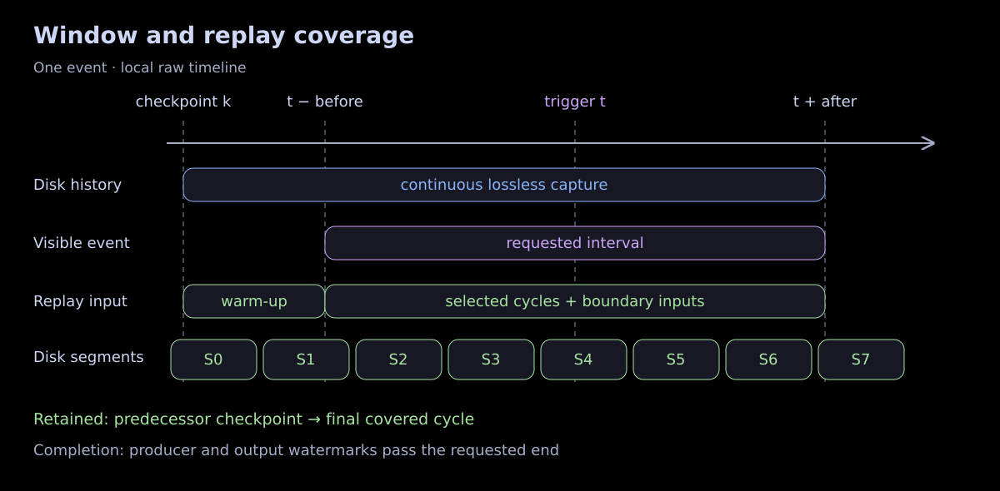
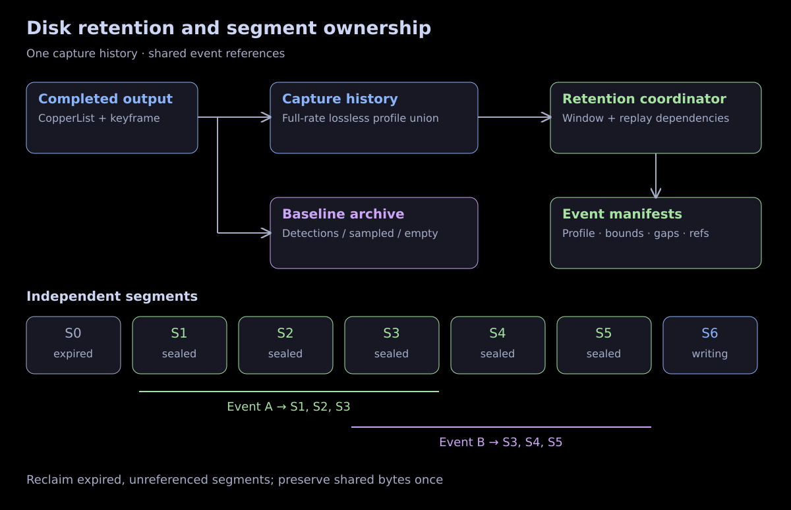
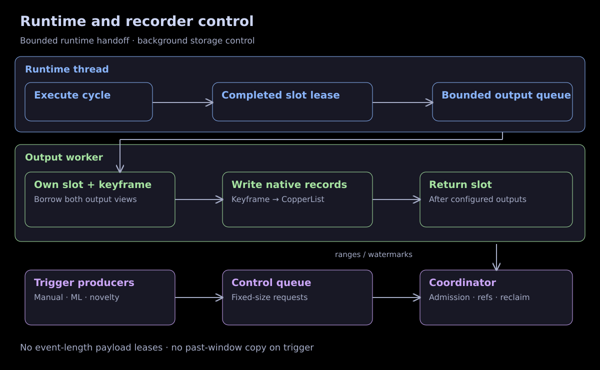
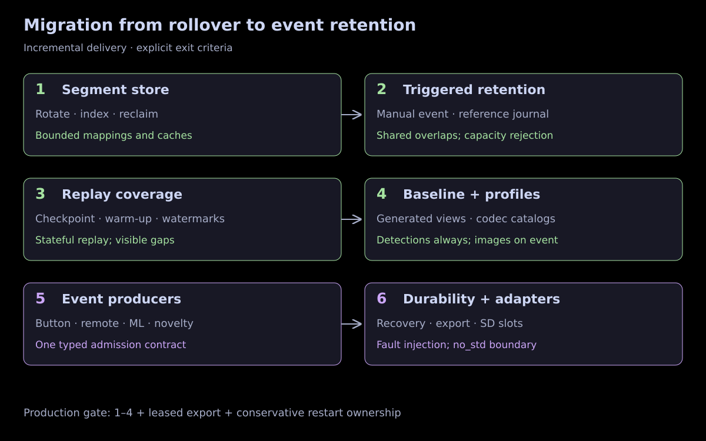

# Event-based logging

Status: proposed architecture and migration plan. No runtime behavior changes in
this document. Existing implementation notes remain in [`doc/design`](../design/README.md).

## Decision

Extend rollover into **retention of independently reclaimable disk segments**.
Continuously capture the data that a future event may require into a bounded disk
history. Keep a separately configured baseline archive. A trigger retains references
to the segments covering its past and future window, including replay dependencies.
It does not copy the past window or hold it in RAM.

Compatibility is optional: preserve an existing API or encoding only when it adds
no complexity or compute. Reuse the current native encoders, catalog recipes, and
section ownership rules because they fit this design. Change configuration, output
routing, and reader APIs where needed. Do not introduce dual writers, legacy mode
dispatch, or a translation pass to maintain compatibility.

The unavoidable cost is continuous high-fidelity capture. A robot that never records
an image cannot retrieve that image after a trigger. “Log nothing normally” means
no permanent baseline payload archive; it still requires temporary disk recording
for every signal eligible for pre-trigger capture. Events reduce retained storage
and upload volume, not the sensor-to-disk bandwidth needed to preserve the past.

## Requirements and scope

| Requirement | Proposed behavior |
| --- | --- |
| Asymmetric window | Independently configure `before` and `after`, including minutes or hours |
| History larger than RAM | Disk history; fixed queues and bounded index caches |
| Minimal baseline | All detections, selected messages, decimation, or no baseline payloads |
| Configurable event fidelity | Named static capture profiles, usually lossless replay inputs |
| Partial graph replay | Recorded boundary inputs plus component state and execution context |
| Manual, ML, dataset novelty | All submit the same small typed trigger request |
| Repeated triggers | Independent event identities; shared retained segments |
| Failure visibility | Requested window, actual coverage, gaps, and durability reported separately |

First implementation: a local `std` recorder using file storage and async runtime
output. Shared trigger/time/profile types remain usable with `no_std`. SD/eMMC
segment slots follow once the file implementation establishes semantics. Upload,
fleet coordination, and feature-vector search are consumers or event producers,
not responsibilities of the logger.

## What Copper does today

These observations come from the checked-in code, rather than an assumed older
slab-per-recording model.

| Current mechanism | Implementation | Consequence for events |
| --- | --- | --- |
| `.rollover(size)` selects `OverwriteOldest` | [`MmapUnifiedLoggerBuilder`](../../core/cu29_unifiedlog/src/memmap.rs), `rollover` | Capacity is bytes, not a guaranteed duration |
| One linked, byte-addressed section chain | [`ByteLogger`](../../core/cu29_unifiedlog/src/byte_log.rs), `add_section_with_context` | Logical order follows links across wrap; sections can cross slab files |
| Prefix reclamation through the last overlap | Same allocator | Pinning an arbitrary section would obstruct the next wrap; skipping it requires a different allocator |
| Static metadata outside the ring | [`ApplicationMetadata`](../../core/cu29_unifiedlog/src/lib.rs), `seal_metadata` | Application identity and decode catalog survive startup rollover |
| Separate descriptor and commit blocks | [`byte_log.rs`](../../core/cu29_unifiedlog/src/byte_log.rs) | Preserve allocator/encoder ownership and generation validation |
| Active-writer claims and idle-stream revocation | Same allocator and `ByteSection` | A live reader or saved event is not currently protected against reuse |
| Bounded completed-output handoff | [`curuntime.rs`](../../core/cu29_runtime/src/curuntime.rs), `RuntimeOutputItem`, `write_completed_output` | One slot lease owns payloads until keyframe and CopperList output finish |
| Keyframe precedes its associated CopperList | Same output engine | Preserve this order across segment boundaries |
| Compiled capture mask and handle policies | [`cu29_derive/src/lib.rs`](../../core/cu29_derive/src/lib.rs), `build_compressed_culist_tuple_encode` | Disabled capture cannot be enabled retroactively |
| All-mission native catalog | [`runtime_macro.rs`](../../core/cu29_derive/src/runtime_macro.rs), `prepare_log_metadata` | Include every potentially captured slot, not just baseline slots |

The current container is format **v3**; its version covers encapsulation, not
payload compatibility. The self-description catalog is independently versioned
(currently **1**) and distinguishes compact and flat CopperList layouts. See
[log storage](../design/log-storage.md), [concurrent logging](../design/concurrent-logging.md),
and [self-description](../design/self-describing-logs.md).

The mmap backend maps backing slabs and keeps their mappings in a vector. Mapped
bytes need not all be resident, but growing that vector forever is not a bounded
history implementation. Segments must be retired and unmapped independently.

## Windows, clocks, and coverage



For an event with anchor `t`, request the closed interval
`[t − before, t + after]`. Clip underflow to the current clock epoch's start and
record that truncation. Check duration overflow and configured maxima before
admission. Both durations may be zero. Keep logical boundaries exact; whole-cycle
and whole-segment retention may preserve extra bytes outside them.

Use the local undisciplined timeline, `RobotClock::raw_now()` / `CuInstant`, for
durations, expiry, and deadlines. Persist a recording-session clock identity:
raw readings from different clock origins are not comparable. Retain `CuTime`,
message `tov`, and clock-correction records for their existing execution/replay
meaning; do not interpret source timestamps as a global arrival order.

A local trigger carries its anchor and origin identity. A remote button defaults
to the robot's receipt time. An external timestamp requires an explicit clock
mapping with uncertainty; preserve both the original timestamp and resolved local
anchor. Reject an unmappable anchor rather than guessing. A delayed ML detector can
anchor to an earlier observed cycle in the same session, within the configured
lateness limit. Return `history_unavailable` when that history has expired.

Record a raw admission instant and sequence identity on completed output items.
Select complete CopperLists whose admission instants lie in the window, plus
the trigger's explicitly referenced cycle if present. At the edges, retain any
additional boundary samples and prior state needed by those cycles. This defines
a **runtime-observation window**: a frame delivered late is selected by the cycle
that observed it. A sensor-exposure-time query is a separate offline selection,
using `tov`; it cannot redefine the recorder's retention guarantee.

Keep these times distinct in the manifest: event anchor, enqueue/receipt time,
admission time, requested bounds, and actual covered bounds. Control-queue latency
counts against the supported trigger lateness.

Completion requires a producer admission watermark beyond the requested end and
an output watermark proving every admitted cycle up to that boundary was written
or explicitly dropped. A wall-clock timer alone is insufficient while output is
backlogged. Persist gaps even when later cycle IDs continue normally.

## Capture profiles and replay

Separate three choices:

1. **Capture:** what reaches the temporary disk history continuously.
2. **Baseline:** what is kept routinely, and at what sampling/fidelity.
3. **Event retention:** which profile and time interval become a saved event.

Compile a finite set of named profiles. Configuration resolves task/channel names
to generated slot indices and typed codec bindings at startup. At runtime a
trigger carries a profile enum/ID, not a task-name list or dynamic graph query.
The continuous capture profile is the union of all armed event requirements,
including their replay warm-up requirements. The baseline may contain other data
and has independent retention and capacity limits.

For the camera/detector example, an illustrative configuration is:

| Setting | Value |
| --- | --- |
| Baseline | Every detector output; no image contents |
| Event profile `perception` | Replay detector and tracker; inject lossless camera output |
| Default event window | 1,800 seconds before; 120 seconds after |
| Trigger overrides | May shorten or extend within declared profile maxima |
| Continuously armed capture | Every camera frame, replay context, and periodic state checkpoints |

These are proposed settings, not fields accepted by today's RON parser. Add typed
profile, duration, sampling, and capacity structures under `logging`; resolve
references at generation/startup. Keep baseline sampling independent of capture
sampling so reducing the permanent archive cannot reduce an armed event's history.

Start with **one canonical lossless event capture encoding per slot**, shared by
all event profiles. Capturing a lower rate or a lossy representation cannot satisfy
a later request for full-rate lossless replay. A profile needing a different
representation must name an additional, statically compiled capture stream.
Reconfiguration that changes capture requirements starts a new capture generation;
it has no pre-trigger coverage before that generation is armed.

The first implementation retains whole shared segments. A profile is a logical
selection over those segments, so an on-robot event may physically retain a
superset of its selected payloads. Export materializes only that profile. This is
an explicit storage tradeoff; add independent capture lanes only if measurements
show that this over-retention dominates. Do not build per-slot files initially.

For a replay profile, declare the subgraph to execute and the boundary outputs to
inject. Code generation can validate that every incoming graph edge is either
inside the selected subgraph or captured at sufficient fidelity. It cannot prove
that a component correctly freezes hidden state or avoids nondeterministic I/O.
Those remain component contracts backed by replay tests.

For example, in `camera → detector → tracker → planner`, replaying the detector
and tracker requires lossless camera outputs and the detector/tracker state.
Replaying only the tracker can instead inject every detector output. Preserve
other incoming edges, asynchronous/background completion choices, bridge inputs,
clock mappings, configuration, mission identity, and scheduling decisions wherever
they affect execution. Disable live actuator effects during replay.

Find a usable checkpoint `k` at or before the first selected cycle. Retain state
and **every necessary input from `k` through the requested end**, not just images
starting at `t − before`. Run the prefix to restore state and suppress its outputs
from the requested event view. Initially retain the current full-component
keyframes; selective component snapshots are a later optimization. A trigger-time
keyframe cannot reconstruct state at the beginning of a past window.

Continuous checkpoint capture must therefore remain enabled even when the baseline
is empty. Today's `keyframe_interval` counts CopperLists; a duration guarantee also
needs a bound on checkpoint age in elapsed time. Advertise measured availability
and reject a replay-complete claim if no usable checkpoint/prefix exists. Partial
graph replay may also need held messages from earlier cycles; either snapshot
those boundary values with the checkpoint or retain their originating records.
An unbounded held-input age cannot have a finite guaranteed storage budget.

Distinguish `complete` (all requested records present) from `replay_ready`
(checkpoint, inputs, and execution context available). Self-description enables
value inspection; deterministic execution still needs the matching application
and compatible component/codec behavior. Never fill a missing recorded input with
a default and label the result deterministic.

## Storage and ownership



Use a segment store above the existing byte logger. Each segment is a bounded log
origin containing ordinary sections, created with append-only allocation. Rotate
on configured byte or elapsed-time limits at a completed-output boundary. Keep an
associated keyframe and CopperList together; define a startup maximum encoded item
size and reserve enough headroom for the pair. Reject an oversized item with a
recorded gap rather than silently spanning an unbounded number of segments.

For the first implementation, each segment contains its own `ApplicationMetadata`
and optional catalog, sealed before its data. That repetition makes every retained
segment independently decodable and avoids persistent pointers to a deleted
metadata owner. Prepare immutable metadata/catalog material on the control side;
segment setup and mapping happen outside the real-time thread. Measure metadata
cost per rotation. Segments are not reconstructed robot applications: opening a
segment must not call resource initialization, assign a new run, or freeze tasks.

The store supplies one recording-session ID and preserves construction/run,
instance, mission, and CopperList identities across segments. The existing
`SectionContext` does not identify a whole recording globally; a fresh byte logger
must not accidentally reset a logical run ID. Introduce internal explicit-context
wiring where necessary. A segment ID includes a persistent store identity and
monotonic sequence or slot generation; a pathname alone is never an identity.

| Segment state | Meaning |
| --- | --- |
| `prepared` | Allocated storage and sealed metadata, ready for output |
| `writing` | Single output owner appends; never eligible for reclamation |
| `sealed` | Immutable data and published range descriptor |
| `reclaimable` | Sealed, outside history guard, no event/export references |
| `recycled` | References removed, storage deleted or reused under a new identity |

Maintain three reasons to keep a segment: the rolling history guard, event
references, and temporary reader/export leases. Overlapping events reference the
same immutable bytes. Reclamation can choose any eligible sealed segment; it is
not constrained to remove a prefix before a pinned section. For mmap, reclaim a
whole segment family and release mappings. Never hard-link a backing slab that
will later be overwritten and call it an archive.

For SD/eMMC, reserve fixed independently reusable segment slots with a generation
per slot and log-relative offsets within each slot. The same retention policy
applies, while filesystem operations remain confined to the host adapter. Preserve
the current separation of descriptor and encoder-commit blocks on block storage.

Range descriptors contain session/context, segment identity, first/last cycle,
raw time bounds, checkpoint locations, capture-generation identity, and gap
summary. Use a disk index with a bounded page cache; neither all segment metadata
nor all event references need to fit in memory. Manifests append reference pages
as events grow. Bound active events, queue capacities, open segments, reader leases,
and metadata cache sizes independently of window duration.

### Trigger and reclamation ordering

One recorder coordinator owns interval admission, event references, and reclaim
decisions. Output publishes completed ranges; trigger producers only enqueue
requests. Before accepting an event, the coordinator installs a retention fence,
resolves the predecessor checkpoint, and protects all required ranges. Lookups
can page through disk metadata under that fence without racing deletion. Reserve
enough bytes for the configured worst-case admission work. If this reserve or the
active-event limit is exhausted, reject the new event before acceptance.

The writing segment is already unreclaimable; accepted future intervals attach to
it and subsequent segments before they become eligible for deletion. Do not force
a synchronous segment flush in the trigger producer. Old history is protected by
the configured lateness guard until admission completes. Disk I/O or coordinator
stall beyond that bound changes coverage/health; it cannot silently preserve the
guarantee.

An export acquires a bounded reader lease before opening segments. Event deletion
releases only that event's references; history guards, other events, and active
exports continue to protect data. Rebuild reference counts from manifests after a
restart; in-memory counts are an acceleration, not the source of truth.

## Output integration and cost



Extend the existing completed-output engine instead of creating a second task
graph or retaining borrowed payloads in an event queue. One `RuntimeOutputItem`
keeps ownership of the CopperList and captured state until its configured outputs
finish. Generate baseline and capture views borrowing that same item. The output
worker writes the checkpoint before the corresponding CopperList in each view.
Only then can the runtime reclaim the arena slot and its pooled image buffers.

Initially, baseline and capture are two native output views. Slots common to both
are encoded twice **on the output worker**. Full images absent from the baseline
are encoded once. This is a deliberate simple implementation, not a free fan-out;
measure duplicate detection/metadata cost before considering byte-span reuse or
disjoint supplemental streams. Those optimizations would add encoding and reader
complexity and are not prerequisites for event retention.

Handle-content policies must belong to the output view. Today's encoder can apply
policies to handle-backed payloads; a baseline `none`/`touched_only` decision must
not leak into lossless capture through shared mutable policy state. Validate both
output orders, including cached codec results, without cloning image payloads.

Require async output for the initial host event recorder. Synchronous users do
not implicitly acquire a second serialization pass in their task thread. Longer
worker occupancy still increases arena/pool pressure, so moving work to a worker
does not remove its capacity cost.

| Cost | Placement and limit |
| --- | --- |
| Trigger submission | Fixed-size request; bounded preallocated queue; immediate `queue_full` |
| Cycle selection timestamp | Raw-time observation and small output-item metadata; benchmark producer latency |
| Checkpoint capture | Existing freeze path, continuously armed; potentially more work than baseline-only mode |
| Capture encoding | Existing native encoding, output worker; full sensor rate |
| Baseline encoding | Output worker; extra pass over selected baseline slots |
| Segment setup, indexing, references | Recorder/storage side; prepared-segment reserve |
| Event admission/export | Control/background work; never copy a window on the trigger caller |

This design does not authorize additional hot-path allocation, payload copies,
serialization, or unmeasured latency. Before runtime implementation, measure the
new producer timestamp/queue work and checkpoint requirements and obtain explicit
agreement for any added hot-path cost. Preallocate event requests and output slots;
do not keep camera-pool handles alive for the duration of the event window.

Keep the current pair-drop behavior under output-queue exhaustion: reject the
CopperList/checkpoint together, count the gap, and invalidate replay readiness
where it matters. Isolate baseline and capture sink health so a failed optional
baseline does not stop a healthy capture stream. A failed capture sink invalidates
affected events, returns owned slots, and reports the error. Do not hide worker
failure behind indefinitely growing queues.

Structured text logging currently runs on its callers and routes through the most
recently installed process-global sink. Event capture does not make it per-instance
or async. Initially leave text logs in their normal archive and record explicit
references where available; do not claim their completeness for an event. Any
clock/lifecycle records required for replay need a context-bound capture path and
must not rely solely on that global text sink.

## Capacity and admission

Use measured encoded rates with a configured worst-case bound. For one capture
lane, a conservative planning rule is:

```text
history_seconds >= max_before + max_trigger_lateness
                 + max_checkpoint_or_held_input_age
                 + 2 * max_segment_duration + max_output_lag

history_bytes >= max_encoded_bytes_per_second * history_seconds
              + checkpoint_bytes + metadata_and_alignment

capture_capacity >= history_bytes + retained_event_bytes
                  + accepted_future_bytes + rotation_and_admission_reserve
```

`retained_event_bytes` counts the physical union of referenced segments, not the
sum of event durations. Treat accepted-future reservations conservatively first;
deduplicating overlap during admission is optional. Baseline has a separate byte
quota. Finite flash cannot guarantee arbitrary before/after lengths, trigger
lateness, retained-event count, or input size: validate all bounds on arming.

At **80 MiB/s**, a 30-minute past window alone needs **140.625 GiB** before
checkpoints, metadata, segment rounding, or saved events. A 120-second future
window adds **9.375 GiB** if it shares no already reserved interval. An empty
baseline does not remove either requirement. Include continuous writes in flash
endurance and storage-throughput budgets.

RAM scales with in-flight runtime items, codec buffers, active control records,
and bounded caches, not `rate × before`. Disk scales with the history horizon and
the union of retained events. Keep both actual temporal coverage and remaining
bytes visible; a byte quota alone cannot promise a time window at variable rates.

On event admission, reserve its bounded future capture and replay-prefix space.
Default policy: reject a new event if preserving it would consume the guaranteed
history/rotation reserve or threaten accepted events. Do not silently shorten
windows, switch to lossy encoding, overwrite accepted events, or block control
execution. Offer explicit retention expiry/offload to release saved data. If the
device violates its advertised rate or I/O bounds, record gaps and mark affected
events incomplete; reservation is not protection against hardware failure.

## Trigger contract and producers

Proposed API vocabulary, not implemented Rust signatures:

```text
request = { producer_sequence, profile_id, anchor, reason_id,
            evidence_reference?, before_override?, after_override? }
try_trigger(request) -> ticket | queue_full | invalid_request
ticket status -> pending | accepted(event_id) | rejected(reason)
event status -> collecting | finalizing | complete | incomplete
```

A ticket means queued, not durable or accepted. The coordinator checks clock,
capture-generation coverage, profile limits, checkpoint availability, deduplication,
and capacity. Accepted events expose coverage and durability separately. A local
producer sequence makes retries idempotent within its persisted producer/session
identity. Reasons are typed IDs; large evidence blobs are ordinary logged data,
referenced by cycle/slot. Public APIs start experimental; generated routing stays
internal. Do not add a new task trait just to issue a logging trigger.

| Producer | Integration |
| --- | --- |
| Manual button | Existing source/task or application control uses a pre-bound trigger handle |
| Remote operator | Adapter submits local receipt anchor, or explicitly mapped remote anchor |
| ML interestingness | Task observes input and submits its cycle reference, score/evidence reference, and profile |
| Dataset novelty | Task compares embeddings with a versioned dataset digest and submits the same request |

Bind a handle through the app builder/resource mechanism; avoid a process-global
trigger singleton. Use bounded producer queues with a defined coordinator order;
the runtime's existing SPSC output queue is not automatically a multi-producer
control queue. Log accepted/rejected decisions and stable event IDs. During replay,
inspect recorded decisions by default; do not create new retained events unless
the operator explicitly runs a trigger-evaluation experiment.

Novelty scoring remains outside the recorder. Preserve model/version,
feature-extractor identity, digest snapshot ID, distance/threshold, and evidence
reference so offline dataset tooling can explain selection. Rate limits and
cooldowns belong to producer/profile policy. Overlapping event requests may share
storage without merging their identities or reasons; keep this first behavior
instead of adding mutable extend/merge semantics immediately.

## Event manifest, self-description, and durability

Introduce a versioned recording-store index and event manifest. Minimum manifest
contents are event/session IDs, producer provenance, resolved clock anchor,
requested/actual bounds, profile/capture-generation identity, ordered segment
references and generations, checkpoint/replay prefix, known gaps, and completion
and durability status. Store ordered references in pages so a long event does not
require a window-sized RAM vector.

Keep the native per-cycle payload encoding and the catalog's exact wire recipes.
Every potential capture slot must have its proper recipe, including lossless image
codecs and handle contents; baseline-disabled slots must not lose their recipe.
If all views use the same envelope and slot wire types, one all-mission catalog
can describe their capture planes. Baseline and capture must have separate codec
state/config identities if their encodings differ. If a view changes a slot's
wire representation, give that view a matching catalog rather than interpreting
it using the baseline catalog.

Version these boundaries independently:

| Boundary | When to change it |
| --- | --- |
| Store/index/manifest | New segment references, event semantics, or durable publication fields |
| Unified-log container | Main/section descriptor, commit, context, or link layout changes |
| Native catalog | Recipe vocabulary, envelope layout, or new view-map semantics |
| Application payload/checkpoint | Typed data or executable restore contract changes |

Independent v3 segments are a suitable starting point because byte-log offsets are
relative to a log origin. This is reuse, not a promise to keep v3. If implementation
needs a new context field or envelope, bump the appropriate version and update
writers/readers together. Do not encode changed layouts under an old catalog
version. Reject unsupported versions clearly. Old recordings can be inspected by
their old tools; an offline converter is separate work only if requested.

Publish retained data in this order:

1. Fence the ranges and durably journal event acceptance/references before allowing
   reclamation. Distinguish pending durability from durable acceptance in status.
2. Seal completed segment data, flush it to the selected durability boundary,
   then publish its descriptor/index entry. The writing segment remains protected.
3. Append reference pages and gap updates. After the end watermark passes, persist
   the final manifest and commit its publication atomically with the store index.
4. On deletion, persist the event tombstone before releasing references. Recycle
   only after checking all durable owners and live reader leases.

Use a journal/transaction protocol for these multi-file steps; a rename alone is
not a transaction spanning segment data, manifest, and directory entries. On file
storage, durable mode includes file and directory synchronization. On block
storage, define ordering and checksummed generation records explicitly. Do not
inherit a power-loss guarantee from current mmap `flush` or `clean_close`.

After an interrupted run, reconstruct ownership from accepted manifests/journal
and valid sealed descriptors before enabling reclamation. Conservatively quarantine
ambiguous segments. An unfinished writing segment is partial salvage, never a
complete event; current append rejects an unclean log. A crash during the future
window yields an incomplete event with the last verified watermark. A new clock
epoch starts new intervals; do not continue a prior event by comparing reset times.

Export acquires leases and produces a self-contained event bundle with metadata,
catalogs, selected streams, checkpoint/prefix, gaps, and provenance. Repack container
links/offsets when materializing a standalone log; copying raw v3 sections without
rewriting their links is invalid. Keep the shared-segment representation on-robot
and perform projection/repacking outside the task thread.

## Step-by-step migration



Each step produces a usable slice and has an exit criterion. Update the existing
implementation notes only as that step lands; this proposal does not relabel
planned behavior as implemented.

| Step | Change and code touchpoints | Exit criterion |
| --- | --- | --- |
| 1. Segment store | Add bounded host segment lifecycle above `ByteLogger`/mmap; supply persistent segment/session and explicit construction identity; add disk range descriptors | Continuous capture rotates and reclaims whole independent segments; mappings and index cache remain bounded through repeated capacity wraps |
| 2. Triggered retention | Add coordinator, fixed trigger requests, history guard, reference journal, and event manifests; use full capture with baseline disabled | Manual asymmetric event retains past and future across rotations; overlaps share bytes; admission/reclamation race and capacity rejection are deterministic |
| 3. Replay-complete event | Add raw-cycle selection/watermarks, checkpoint lookup, prefix/held-input retention, clock/lifecycle capture, and event reader | Replay starts before the visible window and reproduces a stateful task over multiple checkpoints; gaps prevent `replay_ready` |
| 4. Baseline and profiles | Extend `LoggingConfig`/validation and generated views in `cu29_derive`; route both views through the existing completed-output owner; bind catalogs/codecs per representation | Detections persist routinely, images expire without an event, and accepted events contain full-rate lossless replay inputs with measured overhead |
| 5. Producer integrations | Add builder/resource trigger handles, remote adapter, ML example, and versioned novelty-evidence example | Every producer uses the same admission contract; retries, delayed anchors, and flood limits are covered |
| 6. Durable export and embedded adapter | Add crash-recovery publication tests, leased export/offload, SD slot adapter, and gated shared types | Power-cut fault injection never reclaims an owned segment; exported bundles decode independently; shared code preserves `no_std` |

Step 1 can reuse `Grow` inside each bounded segment; it must not use `Grow` for an
unbounded single log. Step 2 retains referenced segments directly, so there is no
temporary implementation that copies a long past window or pins holes inside the
existing prefix-reclaiming ring. Step 3 is required before calling the feature
replay-ready; step 6 is required before advertising power-loss durable acceptance.

The first production feature gate should include steps 1–4, basic leased export,
and conservative restart ownership reconstruction. Earlier steps remain opt-in
engineering milestones. Keep the old ordinary logger available only as long as
maintaining it introduces no extra event-path branches or duplicate format logic.

## Validation and decisions before implementation

Add maintained tests to existing crate suites; no one-off justfile recipes.

| Area | Required evidence |
| --- | --- |
| Long windows | Synthetic recording larger than a fixed test RAM budget; bounded resident/mapped segments, queue depths, and index cache |
| Exact selection | Zero/asymmetric windows, boundary cycles, delayed detector, remote mapping uncertainty, slow output, clock correction, epoch reset |
| Storage lifetime | Wrap during trigger admission/export, overlapping events, event deletion, slot generation reuse, metadata survival, sparse streams |
| Replay | Restore predecessor checkpoint, execute warm-up and selected subgraph, compare outputs across several checkpoint intervals without injecting the tasks under test |
| Fidelity | Baseline detections plus lossless event images; capture planes and catalog/codec parity; retained handle bytes survive arena reuse |
| Overload | Queue full, prepared-segment starvation, storage full, oversized item, missing checkpoint, producer flood, failed sink; no silent completeness claim |
| Restart | Fault injection between every journal/data/index/manifest publication step; accept salvage separately from durable completion |
| Performance | Producer latency distribution, freeze cost, output throughput, slot/pool occupancy, duplicate baseline encoding, metadata/rotation cost, flash writes |

Use the caterpillar determinism harness as the replay pattern and extend a logging
example with a manual trigger and a synthetic high-bandwidth payload. Check native
and self-described exports of the same event. When implementation touches the
runtime, use the narrow root verification targets and `no_std` checks described in
[`copper-workflow`](../../CONTRIBUTING.md#checks).

Before implementation, settle hardware-specific bounds: capture rate/item size,
largest before/after interval, trigger lateness, checkpoint/held-input age, baseline
quota, saved-event quota, storage endurance, and required durability. The architecture
does not depend on those values, but guaranteed admission and latency do. Explicitly
review the proposed producer timestamp/queue and continuous freeze costs against
the robot's real-time budget.
