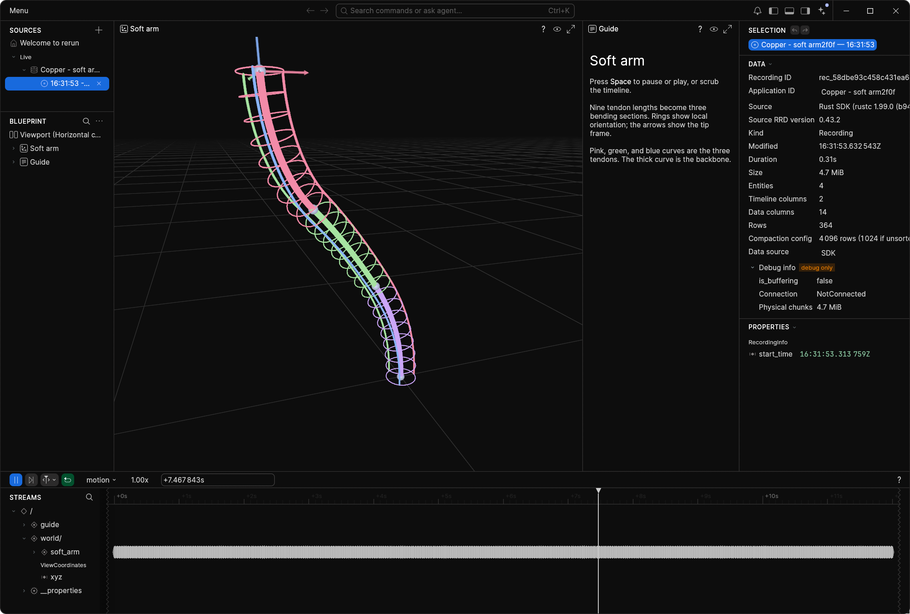

# A custom Rerun representation: a soft robot arm

Nine tendon lengths describe a three-section flexible arm. Rerun can plot those
numbers, but it cannot infer the arm's shape. This example implements Rerun's
`AsComponents` for a Copper payload to reconstruct the backbone, tendons,
orientation rings, section joints, and tip axes.



## Run

From this directory:

```sh
just
```

This runs the Copper graph in [`copperconfig.ron`](copperconfig.ron): a `Motion`
source emits `SoftArm` messages at 30 Hz and a `RerunSink` displays them live in the
embedded Rerun 0.43 viewer. The 12-second gesture repeats until you close the viewer
or press Ctrl-C. Pink, green, and blue curves are the three tendons; the thick
curve is the backbone. Press **Space** to pause the view or scrub `cu_time` while
the Copper app continues recording.

Copper records the original tendon measurements, task keyframes, and structured
logs to `logs/soft-arm_*.copper`. Each run replaces that log family. Closing the
viewer or pressing Ctrl-C stops the tasks and flushes the logs. The live viewer
needs no separate Rerun CLI or debug server.

The first build includes the native viewer and can take a few minutes. A graphical
desktop is required to open it. To record one 12-second gesture to both Copper and
an RRD file without opening a window:

```sh
just save /tmp/soft-arm.rrd
```

For a bounded run or a different Copper log path, pass `--frames` and `--log-base`
to the binary:

```sh
cargo run --bin cu-rerun-soft-arm -- --frames 360 --log-base logs/take-two.copper
```

## Replay in Timetraveler

After closing the live viewer, run:

```sh
just debug
```

This builds the replay binary with `cu29/rerun` and serves the recorded Copper
log through the debug API. In Timetraveler's **Session → Connect** dialog, select
the running `soft-arm-resim` target, or enter:

- Debug base: `copper/examples/cu_rerun_soft_arm/debug/v1`
- Log base: the absolute path to this example's `logs/soft-arm.copper`

Use the base name even though the files on disk have numbered suffixes. Attach,
then click the purple **+** on `motion`'s `SoftArm` payload. Scrubbing the Logged
timeline should show the same changing arm. Replay and select the corresponding
payload in Replayed to inspect its representation there too.

[`resim.rs`](src/resim.rs) uses the same graph in simulation mode. Copper injects
the recorded source messages and skips the live Rerun sink. The server computes
the representation on request through the payload's reflection attribute. Replay
output goes to separate per-session `logs/replay_*.copper` files.

To replay another take: `just debug logs/take-two.copper`. Timetraveler can also
launch `target/debug/soft-arm-resim` from the workspace root directly; it accepts
the standard `--debug-base`, `--log-base`, and `--replay-log-base` flags.

## Adapt it to your type

1. Keep domain data in the payload. [`SoftArm`](src/lib.rs) stores three
   `TendonSection`s, each containing three `Length`s and a routing radius. It
   implements Copper's normal payload traits; no geometry is stored in messages.
2. Implement [`AsComponents`](src/representation.rs). Here the tendon lengths
   become constant-curvature sections, composed from base to tip. Native
   `LineStrips3D`, `Points3D`, and `Arrows3D` batches are combined on one entity.
   Replace this calculation with your own representation.
3. Log it directly, as the sink in [`tasks.rs`](src/tasks.rs) does:

   ```rust
   recording.log("world/soft_arm", arm)?;
   ```

For Copper's debug API, attach the optional reflection attribute to the same type:

```rust
#[derive(Debug, Clone, Default, Serialize, Deserialize, Encode, Decode, Reflect)]
#[cfg_attr(feature = "rerun", reflect(@cu_rerun::representation::<Self, cu_rerun::views::Spatial3DView>()))]
pub struct SoftArm {
    pub sections: [TendonSection; 3],
}
```

The `rerun` feature enables `cu-rerun`, `cu29/reflect`, and the representation
module. `app` adds the Copper tasks, `viewer` adds the live app and desktop viewer,
and `debug` adds the replay server. The viewer is enabled by default;
`cargo check -p cu-rerun-soft-arm --no-default-features` builds just the payload.
See the complete wiring in [`Cargo.toml`](Cargo.toml).

In an application that uses this payload, enable the payload's `rerun` feature
and `cu29/rerun` in the replay/debug server. Copper discovers the attribute through
the existing reflected type, calls the same `AsComponents`, and sends the Rerun
components to Timetraveler. There is no second renderer or separate registration
list. For task state, attach it to the projected state type exposed through
`with_debug_state` / `debug_state_type_path`; see [cu-rerun](../../components/libs/cu_rerun).

The representation uses existing Rerun visualizers. A custom renderer would still
need to be installed in the receiving viewer; the attribute does not ship renderer
code. The test in `representation.rs` verifies that local logging and the debug
adapter encode identical component arrays. The replay integration test records
the real graph and checks logged/replayed geometry over the CBOR debug transport,
including seeks across a keyframe and backwards.

## Geometry model

The three tendons are equally spaced around each section. Their mean length gives
the backbone length; their differences determine the bend direction and angle.
Section frames are composed along the arm, so bending a lower section moves every
section above it. Equal tendon lengths produce a straight section.

This follows Open Continuum Robotics' [tendon-driven constant-curvature model](https://www.opencontinuumrobotics.com/101/2022/12/09/tdcr-cc-model.html)
and [arc kinematics](https://www.opencontinuumrobotics.com/101/2022/12/02/cc-kinematics.html).
It assumes continuous tendon routing and no twist. It is a geometric illustration,
not a force solver: gravity, friction, tendon slack, and collisions are not modeled.
